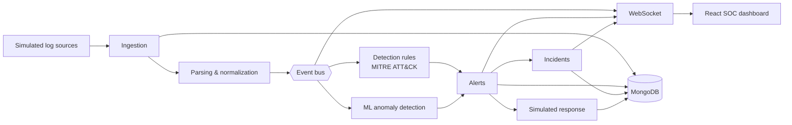

# SOC-Lite

**SOC-Lite (Security Operations Center Lite)** is a real-time security event monitoring,
threat detection and simulated incident response platform built with **Python FastAPI**,
**React + TypeScript**, **MongoDB** and **Scikit-learn**.

It ingests security logs, normalizes them, detects threats with MITRE ATT&CK-mapped
rules and machine-learning anomaly detection, manages alerts and incidents, and runs
**simulated** automated response playbooks. All of this is shown on a dark-themed SOC
dashboard with live updates.

> ⚠️ **Simulation only.** SOC-Lite is a learning and demonstration platform. It runs on
> simulated data, and its automated response never executes commands, blocks real IPs or
> disables real accounts. See [ADR-0003](docs/adr/0003-simulated-response-only.md).

## Project status

🚧 **In development. Day 1 of 30: architecture and design.**
Track progress in the [roadmap](docs/roadmap.md).

## Features (planned)

| # | Feature | Highlights |
|---|---|---|
| 1 | Real-time log collection | HTTP ingest (API keys), file tailer, syslog, simulator |
| 2 | Parsing & normalization | SSH/auth, Nginx, firewall, JSON → common event schema |
| 3 | Threat detection engine | Sliding-window rules with **MITRE ATT&CK** mapping |
| 4 | Suspicious login detection | Impossible travel, new country, off-hours, success-after-failures |
| 5 | Brute-force detection | Classic, password spraying, distributed |
| 6 | Alert management | Dedup, lifecycle, assignment, comments, evidence |
| 7 | SOC dashboard | Dark theme, Recharts, severity indicators, MITRE heatmap, live feed |
| 8 | Incident tracking | Alert grouping, timeline, MTTA/MTTR |
| 9 | Automated response (simulated) | Playbooks, approval, dry-run, revert, simulated blocklist |
| 10 | ML anomaly detection | Scikit-learn IsolationForest, versioned model registry |
| + | Audit logging | Append-only log of all security-relevant actions |

## Architecture

Full details: [docs/architecture.md](docs/architecture.md).

## Tech stack

| Layer | Technology |
|---|---|
| Frontend | React, TypeScript, Vite, Tailwind CSS, Recharts, TanStack Query |
| Backend | Python, FastAPI, Pydantic v2, uv |
| Database | MongoDB (Docker Compose) |
| Detection / ML | Python rules engine, Scikit-learn |
| Auth | JWT access tokens + rotating refresh tokens, Argon2id, RBAC |
| Tooling | pytest, Vitest, ruff, mypy, ESLint, GitHub Actions, gitleaks |

## Documentation

| Topic | Link |
|---|---|
| Architecture & modules | [docs/architecture.md](docs/architecture.md) |
| Database schema | [docs/database-schema.md](docs/database-schema.md) |
| API design | [docs/api.md](docs/api.md) |
| Security architecture & audit logging | [docs/security.md](docs/security.md) |
| MITRE ATT&CK mapping | [docs/mitre-attack.md](docs/mitre-attack.md) |
| Simulated data & attack scenarios | [docs/simulation.md](docs/simulation.md) |
| Dashboard design | [docs/frontend.md](docs/frontend.md) |
| Developer guide | [docs/development.md](docs/development.md) |
| Roadmap | [docs/roadmap.md](docs/roadmap.md) |
| Decision records | [docs/adr/](docs/adr/README.md) |

## Getting started

Installation instructions will be added as the backend, frontend and Docker Compose
scaffolding land (Days 2–4). Planned prerequisites: Docker, Python 3.12+ with `uv`,
Node.js LTS.

## Contributing

Work happens on feature branches with [Conventional Commits](https://www.conventionalcommits.org/)
and pull requests. See the [developer guide](docs/development.md).

## License

[MIT](LICENSE)
