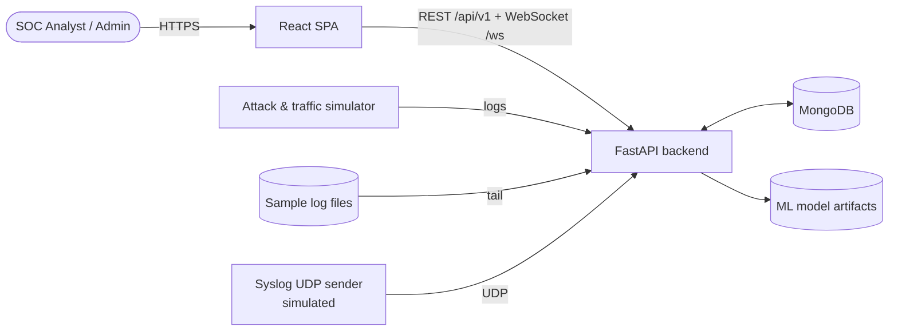
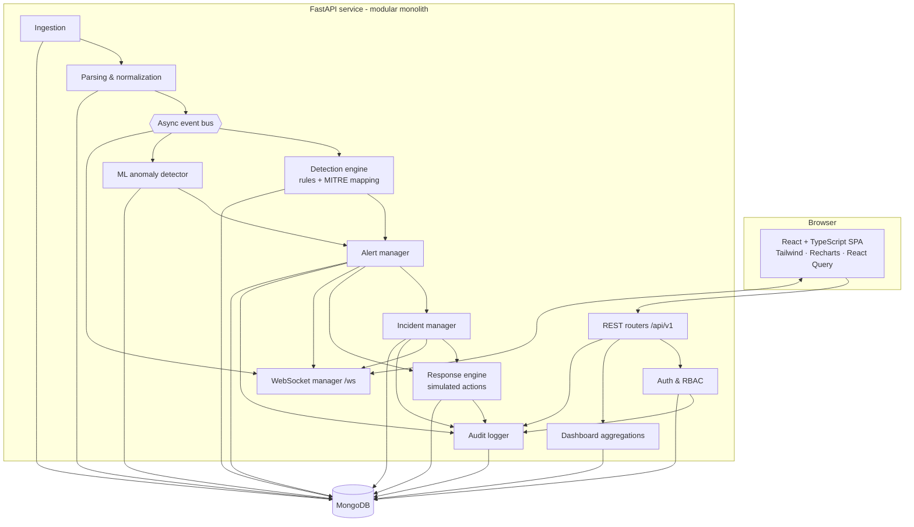

# Architecture

> Status: **Approved design (Day 1)**. Implementation is incremental; see [roadmap.md](roadmap.md).
> Sections describe the target system. Anything not yet built is marked *planned* in the roadmap.

## 1. Goals and non-goals

**Goals**

- Demonstrate a realistic, end-to-end Security Operations Center workflow:
  collect → normalize → detect → alert → investigate → respond.
- Clean, modular, testable code that a reviewer can follow module by module.
- Map detections to MITRE ATT&CK so alerts carry analyst-relevant context.
- Run entirely on simulated data, reproducibly, on a laptop via Docker Compose.

**Non-goals**

- Monitoring real production systems or real networks.
- Executing any response action against real infrastructure. All automated response is
  **simulated** (see [ADR-0003](adr/0003-simulated-response-only.md)).
- Horizontal scale. SOC-Lite is a single-node system designed so it *could* be split later.

## 2. System context



## 3. Container view



## 4. Event pipeline

```mermaid
sequenceDiagram
    autonumber
    participant Src as Log source (simulated)
    participant Ing as Ingestion
    participant Par as Parser/Normalizer
    participant Bus as Event bus
    participant Det as Detection engine
    participant ML as ML detector
    participant Alr as Alert manager
    participant Inc as Incident manager
    participant Rsp as Response engine
    participant UI as Dashboard (WebSocket)

    Src->>Ing: raw log line(s)
    Ing->>Ing: validate size, auth (API key), store raw_logs
    Ing->>Par: raw log
    Par->>Par: detect format, parse, normalize, enrich (geo)
    Par->>Bus: publish event.normalized
    Bus->>UI: live event feed
    Bus->>Det: evaluate rules (sliding windows)
    Bus->>ML: update feature window, score
    Det->>Alr: Finding (rule, severity, MITRE, evidence)
    ML->>Alr: Finding (anomaly score, features)
    Alr->>Alr: fingerprint + dedupe / suppress
    Alr->>UI: alert.created / alert.updated
    Alr->>Inc: auto-group by entity + time window
    Alr->>Rsp: matching playbooks
    Rsp->>Rsp: simulated action (blocklist / disable flag / notify)
    Rsp->>UI: response.executed
```

## 5. Backend design

### 5.1 Layering

Every module under `backend/app/modules/<name>/` uses the same layers:

| File | Responsibility |
|---|---|
| `router.py` | HTTP/WebSocket endpoints, request/response models, auth dependencies. No business logic. |
| `service.py` | Business logic. Pure where possible; depends on repository interfaces. |
| `repository.py` | MongoDB access only. The only layer that builds queries. |
| `schemas.py` | Pydantic v2 models (API contracts and internal DTOs). |
| `deps.py` | FastAPI dependency wiring for the module. |

Modules talk to each other through **services** or the **event bus**, never through
another module's repository.

### 5.2 Planned folder structure

```
soc-lite/
├── backend/
│   ├── app/
│   │   ├── main.py            # app factory, lifespan, router mounting
│   │   ├── core/              # config, security primitives, logging, error handlers
│   │   ├── db/                # Mongo client, index bootstrap, seed
│   │   ├── common/            # event bus, pagination, time utils, shared types
│   │   ├── modules/
│   │   │   ├── auth/  users/  audit/
│   │   │   ├── ingestion/     # collectors: http, file tailer, syslog, simulator adapter
│   │   │   ├── parsing/       # parsers/ + normalizer + geo enrichment
│   │   │   ├── events/
│   │   │   ├── detection/     # engine, rules/, mitre.py
│   │   │   ├── ml/            # features, train, detector, registry
│   │   │   ├── alerts/  incidents/
│   │   │   ├── response/      # playbooks, actions (simulated), executor
│   │   │   ├── dashboard/  realtime/
│   │   └── simulator/         # scenarios, datasets, seeded generators
│   ├── tests/                 # unit/ + integration/ + security/
│   ├── pyproject.toml         # managed with uv
│   └── Dockerfile
├── frontend/
│   ├── src/
│   │   ├── api/  components/  features/  hooks/  layouts/  lib/  pages/  sample/  theme/  (auth/ planned)
│   ├── package.json
│   └── Dockerfile
├── docs/
├── scripts/
├── .github/
├── docker-compose.yml
└── .env.example               # placeholders only
```

### 5.3 Modules

| Module | Responsibility |
|---|---|
| **Ingestion** | Receives logs from `POST /api/v1/ingest/logs` (API key), a file tailer, a syslog UDP listener and the simulator. Enforces size limits and a bounded queue (backpressure). Stores raw lines in `raw_logs` (TTL). |
| **Parsing & normalization** | Pluggable parsers (SSH/auth.log, Nginx access, firewall, generic JSON) behind a `Parser` protocol with `can_parse()` / `parse()`. Outputs a normalized event (simplified ECS). Parse failures are retained and flagged, never dropped. Enriches IPs with geo data from a static, simulated lookup table. |
| **Event bus** | In-process `asyncio.Queue`-based publish/subscribe behind an interface (see [ADR-0002](adr/0002-in-process-event-bus.md)). |
| **Detection engine** | Runs registered rules over normalized events using sliding-window state. Each rule declares its MITRE ATT&CK technique(s). Rule parameters live in `detection_rules` and are editable by admins. See [mitre-attack.md](mitre-attack.md). |
| **Suspicious login rules** | Impossible travel, new country for user, off-hours login vs. baseline, success after repeated failures, login to disabled/privileged account. |
| **Brute-force rules** | Classic (one IP → one user), password spraying (one IP → many users), distributed (many IPs → one user). |
| **ML anomaly detection** | Scikit-learn `IsolationForest` over per-entity time-window features. Versioned model registry with integrity hashes. See [ADR-0006](adr/0006-isolation-forest-anomaly-detection.md). |
| **Alert manager** | Deduplicates findings via fingerprint + suppression window; lifecycle `new → acknowledged → in_progress → resolved / false_positive`; assignment, comments, evidence links. |
| **Incident manager** | Groups alerts (manual or automatic by shared entity within a window); timeline; owner; priority; MTTA/MTTR metrics. |
| **Response engine** | Playbooks (`trigger → actions`), auto or approval mode, dry-run, revert. Actions write only to SOC-Lite's own collections. |
| **Audit** | Append-only record of security-relevant actions. See [security.md §7](security.md#7-audit-logging). |
| **Dashboard** | Aggregation endpoints for KPIs, time series and top-N. |
| **Realtime** | WebSocket fan-out of events, alerts, incidents and response actions by topic. |
| **Simulator** | Seeded generators for baseline traffic and attack scenarios. See [simulation.md](simulation.md). |

### 5.4 Error handling and validation

- All request bodies and query params are Pydantic models with explicit constraints
  (lengths, enums, ranges). Unknown fields are rejected on write endpoints.
- Errors are returned as RFC 7807 `application/problem+json`, with a stable `type`
  and a request ID. Internal exceptions never leak stack traces to clients.
- Domain errors (`NotFound`, `Conflict`, `PermissionDenied`, `ValidationFailed`) are
  raised by services and mapped to HTTP by a central handler.
- Pipeline errors (e.g., a parser crash) are isolated: the failing record is flagged and
  logged; the pipeline continues.

## 6. Frontend design

See [frontend.md](frontend.md) for the full frontend architecture, design system and
current limitations.

**Implemented (Day 3):** the application shell and routing, the design system, the API
client, and a dashboard built on clearly labelled simulated data.

- **Stack:** React 19 + TypeScript (Vite), Tailwind CSS 4, Recharts, React Router,
  TanStack Query, Zod.
- **Routing:** one route table (`src/routes.ts`) drives the navigation, placeholder pages
  and the router. Pages are lazy-loaded; error boundaries keep the shell usable if a page
  crashes.
- **API layer:** a single `request()` function validates every response with Zod and
  throws a typed `ApiError`; React Query handles caching and retries (transient failures
  only). `GET /api/v1/health` is the **only live backend integration**.
- **Dashboard data:** reads through a `DashboardDataSource` interface. The only
  implementation is simulated (`src/sample`); the dashboard API contracts are provisional.
- **Structure:** `api/`, `components/`, `features/<area>/`, `hooks/`, `layouts/`,
  `sample/`, `theme/`, `lib/`.

**Planned (not yet implemented):**

- **Auth:** access token kept in memory only; refresh token is an `httpOnly` cookie;
  silent refresh on 401 (Day 8). No authentication or authorization exists in the
  frontend yet.
- **Realtime:** a single `useRealtime(topics)` hook manages the WebSocket, reconnects with
  backoff, and updates React Query caches (Day 22).
- Alerts, incidents, events, rules, response, ML, audit and administration pages
  (Days 14–29); today they are placeholders.

## 7. Deployment (development)

`docker-compose.yml` will run three services: `mongo` (auth enabled, least-privilege
app user), `backend` (uvicorn), and `frontend` (Vite dev server). Configuration comes
from environment variables; `.env.example` documents them with placeholders.

## 8. Architecture decision records

| ADR | Decision |
|---|---|
| [0001](adr/0001-modular-monolith.md) | Modular monolith with FastAPI |
| [0002](adr/0002-in-process-event-bus.md) | In-process async event bus behind an interface |
| [0003](adr/0003-simulated-response-only.md) | Automated response is simulated only |
| [0004](adr/0004-jwt-with-rotating-refresh-tokens.md) | Short-lived JWT + rotating opaque refresh tokens |
| [0005](adr/0005-mongodb-document-store.md) | MongoDB with PyMongo's async API |
| [0006](adr/0006-isolation-forest-anomaly-detection.md) | IsolationForest for anomaly detection |
| [0007](adr/0007-mitre-attack-mapping.md) | MITRE ATT&CK mapping as rule metadata |
