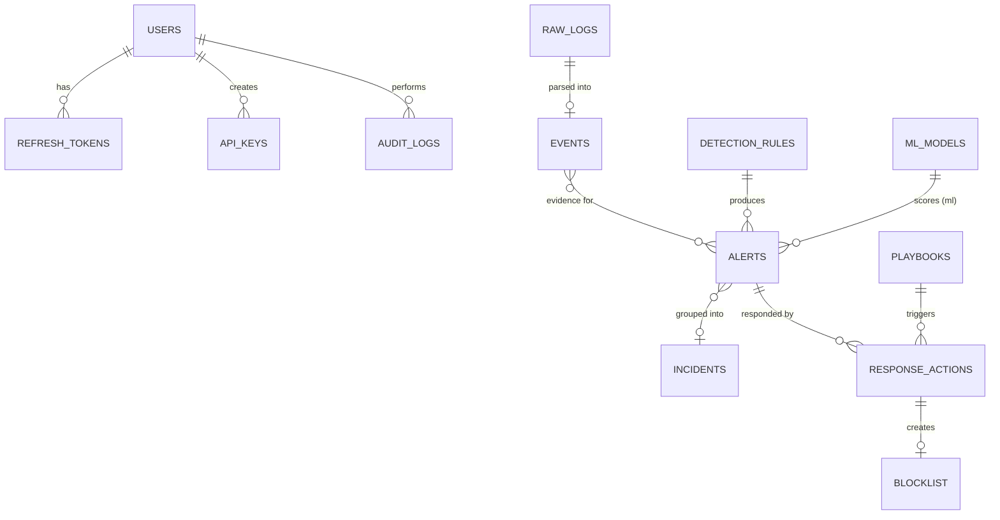

# Database Schema (MongoDB)

> Status: **Approved design (Day 1)**. Collections are created incrementally; indexes are
> bootstrapped by `backend/app/db/indexes.py` (planned, Day 5).

## Conventions

- All timestamps are stored as BSON `Date` in **UTC**.
- `_id` is an `ObjectId`; the API serializes it as a string `id`.
- Secrets are never stored in plaintext: passwords use Argon2id, refresh tokens and API
  keys are stored as SHA-256 hashes.
- Collections holding high-volume data use TTL indexes to bound storage.

## Entity relationships

## Collections

### `users`

| Field | Type | Notes |
|---|---|---|
| `email` | string | unique |
| `username` | string | unique |
| `password_hash` | string | Argon2id |
| `role` | enum | `admin` \| `analyst` \| `viewer` |
| `is_active` | bool | |
| `failed_login_count` | int | for lockout |
| `locked_until` | date? | |
| `created_at`, `last_login_at` | date | |

Indexes: unique `email`, unique `username`.

### `refresh_tokens`

| Field | Type | Notes |
|---|---|---|
| `user_id` | ObjectId | |
| `token_hash` | string | SHA-256 of opaque token |
| `family_id` | string | rotation family; reuse revokes family |
| `expires_at` | date | TTL |
| `revoked_at` | date? | |
| `created_ip`, `user_agent` | string | |

Indexes: unique `token_hash`; `family_id`; TTL on `expires_at`.

### `api_keys`

| Field | Type | Notes |
|---|---|---|
| `name` | string | |
| `key_prefix` | string | first 8 chars, for lookup/display |
| `key_hash` | string | SHA-256 of full key |
| `scopes` | string[] | e.g. `ingest:write` |
| `created_by` | ObjectId | |
| `last_used_at` | date? | |
| `revoked` | bool | |

Indexes: unique `key_prefix`.

### `raw_logs`

| Field | Type | Notes |
|---|---|---|
| `received_at` | date | TTL (default 7 days) |
| `source_type` | enum | `http` \| `file` \| `syslog` \| `simulator` |
| `source_name` | string | |
| `raw` | string | bounded length |
| `parse_status` | enum | `pending` \| `parsed` \| `failed` |
| `parse_error` | string? | |
| `event_id` | ObjectId? | |

Indexes: TTL `received_at`; `parse_status`.

### `events` (normalized)

| Field | Type | Notes |
|---|---|---|
| `timestamp` | date | event time (from log) |
| `ingested_at` | date | |
| `category` | enum | `authentication` \| `network` \| `web` \| `process` \| `file` |
| `action` | string | e.g. `ssh_login`, `http_request`, `connection_denied` |
| `outcome` | enum | `success` \| `failure` \| `unknown` |
| `severity` | int | 0–10 |
| `source` | object | `ip`, `port`, `geo{country, city, lat, lon}` |
| `destination` | object | `ip`, `port` |
| `user` | object | `name`, `id?` |
| `host` | object | `name` |
| `http` | object? | `method`, `path`, `status`, `bytes` |
| `scenario_id` | string? | simulator scenario tag, for demos/tests |
| `raw_log_id` | ObjectId | |
| `tags` | string[] | |

Indexes: `timestamp` desc; `{source.ip, timestamp}`; `{user.name, timestamp}`;
`{category, outcome, timestamp}`; optional TTL (default 30 days).

### `detection_rules`

| Field | Type | Notes |
|---|---|---|
| `key` | string | unique, stable identifier (e.g. `brute_force.classic`) |
| `name`, `description` | string | |
| `type` | enum | `rule` \| `ml` |
| `enabled` | bool | |
| `severity` | enum | `low` \| `medium` \| `high` \| `critical` |
| `params` | object | rule-specific (threshold, window_s, …), validated per rule |
| `mitre` | object[] | `{tactic_id, tactic, technique_id, technique, subtechnique_id?}` |
| `updated_by`, `updated_at` | | |

Indexes: unique `key`.

### `alerts`

| Field | Type | Notes |
|---|---|---|
| `rule_key` | string | |
| `title` | string | |
| `severity` | enum | |
| `status` | enum | `new` \| `acknowledged` \| `in_progress` \| `resolved` \| `false_positive` |
| `fingerprint` | string | hash of rule + key entities, for dedupe |
| `first_seen`, `last_seen` | date | |
| `count` | int | deduplicated occurrences |
| `entities` | object | `ips[]`, `users[]`, `hosts[]` |
| `mitre` | object[] | copied from rule at creation time |
| `evidence_event_ids` | ObjectId[] | capped |
| `ml_score` | float? | for ML alerts |
| `assignee_id` | ObjectId? | |
| `incident_id` | ObjectId? | |
| `comments` | object[] | `{author_id, ts, body}` |
| `created_at`, `updated_at` | date | |

Indexes: `{status, severity, created_at}`; `fingerprint`; `incident_id`;
`mitre.technique_id`.

### `incidents`

| Field | Type | Notes |
|---|---|---|
| `number` | string | unique, `INC-0001` |
| `title` | string | |
| `severity`, `priority` | enum | |
| `status` | enum | `open` \| `investigating` \| `contained` \| `resolved` \| `closed` |
| `owner_id` | ObjectId? | |
| `alert_ids` | ObjectId[] | |
| `entities` | object | union of alert entities |
| `mitre` | object[] | union of alert techniques |
| `timeline` | object[] | `{ts, actor_id, type, message}` |
| `opened_at`, `acknowledged_at`, `resolved_at` | date | MTTA/MTTR |

Indexes: unique `number`; `{status, opened_at}`.

### `playbooks`

| Field | Type | Notes |
|---|---|---|
| `name` | string | |
| `enabled` | bool | |
| `mode` | enum | `auto` \| `approval` |
| `dry_run` | bool | |
| `trigger` | object | `rule_keys[]`, `min_severity`, `mitre_technique_ids[]?` |
| `actions` | object[] | `{type, params}`; `type` ∈ simulated action catalog |

### `response_actions`

| Field | Type | Notes |
|---|---|---|
| `playbook_id`, `alert_id`, `incident_id` | ObjectId? | |
| `type` | enum | `block_ip` \| `disable_user` \| `notify` \| `escalate` \| `open_incident` |
| `params` | object | |
| `status` | enum | `pending_approval` \| `executed` \| `failed` \| `reverted` \| `rejected` |
| `dry_run` | bool | |
| `simulated` | bool | **always `true`**; enforced in code and tests |
| `executed_by` | ObjectId \| `"system"` | |
| `executed_at`, `reverted_at` | date? | |
| `result` | object | |

Indexes: `{status, executed_at}`; `alert_id`; `incident_id`.

### `blocklist` (simulated)

| Field | Type | Notes |
|---|---|---|
| `type` | enum | `ip` \| `user` |
| `value` | string | |
| `reason` | string | |
| `source_action_id` | ObjectId | |
| `expires_at` | date? | TTL |
| `created_at` | date | |

Indexes: unique `{type, value}`; TTL `expires_at`.

### `ml_models`

| Field | Type | Notes |
|---|---|---|
| `name`, `version` | string, int | |
| `algorithm` | string | `isolation_forest` |
| `features` | string[] | |
| `params` | object | hyperparameters |
| `metrics` | object | e.g. precision/recall on labelled simulated data |
| `trained_at` | date | |
| `artifact_path` | string | relative to fixed model dir |
| `sha256` | string | verified before load |
| `is_active` | bool | |

Indexes: unique `{name, version}`.

### `audit_logs` (append-only)

| Field | Type | Notes |
|---|---|---|
| `ts` | date | |
| `actor_id` | ObjectId \| `"system"` | |
| `actor_role` | string | |
| `action` | string | from the audit catalog in [security.md](security.md#7-audit-logging) |
| `outcome` | enum | `success` \| `failure` \| `denied` |
| `target_type`, `target_id` | string | |
| `ip`, `user_agent`, `request_id` | string | |
| `details` | object | sanitized; never contains secrets |

Indexes: `ts` desc; `{actor_id, ts}`; `{action, ts}`. The application exposes no update
or delete operations for this collection.
